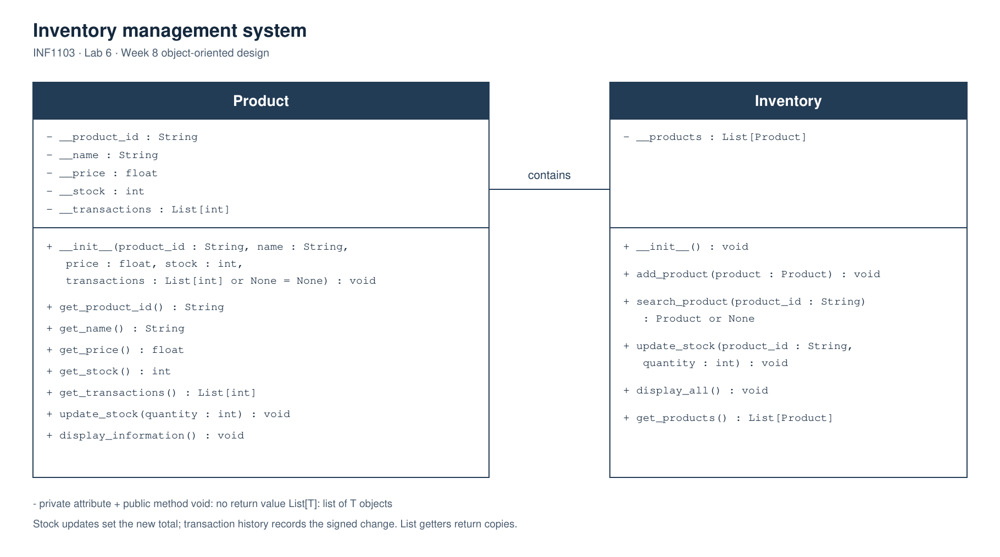

# Lab 6 class diagram

The [SVG diagram](class_diagram.svg) is scalable. The [PNG diagram](class_diagram.png) is ready to view or include in the lab submission.

Each class has three compartments, following the Week 8 lecture: class name, attributes and methods. A minus sign (`-`) means private; a plus sign (`+`) means public. Attribute types, parameter types and method return types are shown. `String` corresponds to Python's `str`, `List[int]` corresponds to a list of integers, and `void` means that the method returns no value. The implicit Python `self` parameter is omitted from the UML.

`Product` manages one product. Its optional `transactions` constructor parameter preserves history when products are loaded from the Week 5 JSON format. Calling `update_stock(quantity)` sets the new stock total and records `quantity - previous_stock` in that history. For example, changing 15 units to 12 units records `-3`.

`Inventory` holds a list of `Product` objects. The plain association labelled **contains** shows this relationship. `Inventory.update_stock()` locates the product and calls its public stock-update method. `search_product()` returns the matching product, or `None` if no product has that ID.

The getters for transactions and products return copies of their lists. Adding or removing an item from either returned list does not change the corresponding private list. The product objects in the inventory copy are still the existing product objects and should be used through their public methods.

There are only two application classes. The main program and the JSON file-handling functions have separate responsibilities but are not classes, so they do not appear as class boxes.
