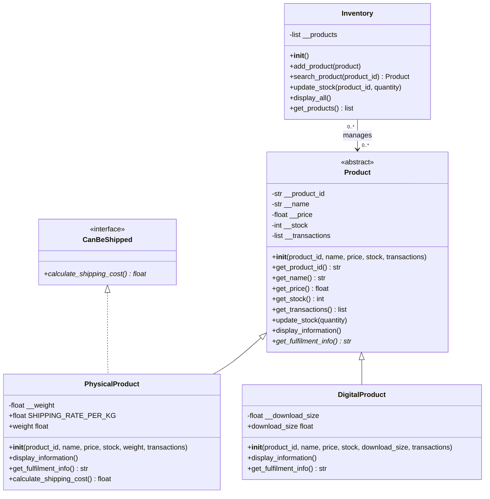

# Lab 7 UML class diagram

Solid lines with hollow triangles show inheritance; the dashed line with a hollow
triangle shows interface realisation. Italic methods (marked with `*` in Mermaid)
are abstract. `weight` and `download_size` are read-only properties.
Inventory holds references to Product objects; it delegates product behaviour.
The code permits a product object to be referenced by more than one Inventory.
